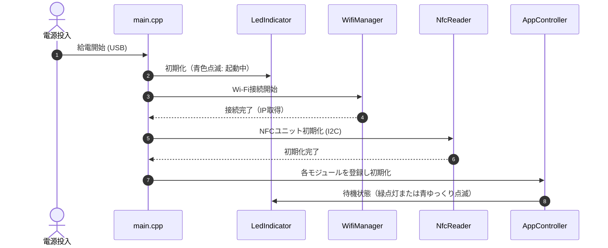
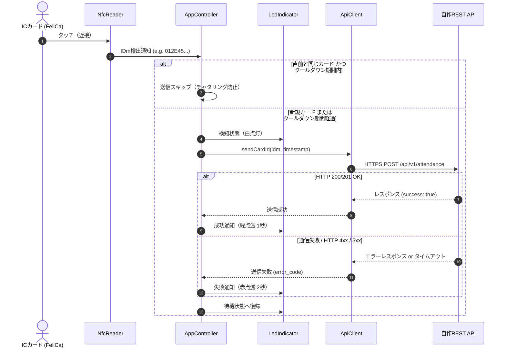

# アーキテクチャ設計 (Architecture)

本書は、`studyspace-card-reader` のソフトウェア構成、モジュール責務、および処理フローについて記述します。

---

## 1. 設計方針

1. **単一責任の原則 (SRP)**:
   - `main.cpp` に処理を集中させず、NFC制御、Wi-Fi接続、API通信、状態表示（LED）を独立したモジュールへ分離します。
2. **テスト容易性 (Testability)**:
   - ハードウェア依存部（ESP32固有機能、I2C通信、HTTP通信）はインターフェース（抽象クラス）を介して呼び出せる設計とし、PC上のNative環境での単体テスト・モックテストを可能にします。
3. **過度な複雑化の回避**:
   - リソースの限られたマイコン上で動作するため、過剰な抽象化フレームワークは避け、最小限の依存性注入（DI）とイベント駆動型/状態遷移モデルを採用します。

---

## 2. ソフトウェアモジュール構成

```
src/
├── main.cpp                  # エントリポイント（setup / loop、各モジュールの協調）
├── app/
│   ├── app_controller.h/.cpp # アプリケーションロジック（状態管理、連続読取防止）
│   └── card_event.h          # カード検知イベント構造体
├── nfc/
│   ├── nfc_reader.h          # NFC読み取り抽象インターフェース
│   └── m5_nfc_reader.h/.cpp  # M5Unit-NFCを用いた具象実装
├── network/
│   ├── wifi_manager.h/.cpp   # Wi-Fi接続維持・再接続制御
│   ├── api_client.h          # API送信インターフェース
│   └── https_api_client.h/.cpp # HTTPClient / WiFiClientSecureを用いた具象実装
└── ui/
    ├── led_indicator.h       # 状態表示インターフェース
    └── ws2812_indicator.h/.cpp # ATOMS3 Lite内蔵RGB LED制御
```

### モジュール別責務

| モジュール | 責務 | 主な依存先 |
| :--- | :--- | :--- |
| **AppController** | 端末の全体状態遷移、同一カード連続読取防止タイマー、イベントの調停 | 各インターフェース |
| **NfcReader** | NFCハードウェアの初期化、FeliCaポーリング、IDm抽出 | M5Unit-NFC, Wire (I2C) |
| **WifiManager** | Wi-Fi接続の確立、定期的な接続死活監視、自動再接続 | WiFi.h |
| **ApiClient** | ペイロード生成（JSONシリアライズ）、HTTPS POSTリクエスト、ステータス判定 | HTTPClient, WiFiClientSecure, ArduinoJson |
| **LedIndicator** | 端末ステータス（待機、カード検知、送信中、成功、異常）に応じたLED発光制御 | FastLED または NeoPixel (ESP32-S3 GPIO35) |

---

## 3. 処理フロー

### 3.1 起動シーケンス


### 3.2 カード検知・API送信シーケンス


---

## 4. エラーハンドリング方針

1. **NFCユニット未接続 / I2Cエラー**:
   - 起動時に検出された場合、LEDを赤点滅させ、定期的にI2C再初期化を試みます。
2. **Wi-Fi切断**:
   - `WifiManager` がバックグラウンド（または `loop()` 内）で接続を監視し、自動で再接続処理を行います。切断中はカード読取を行ってもAPI送信失敗となるため、UIで切断中ステータスを明示します。
3. **API送信タイムアウト**:
   - HTTPSリクエストには適切なタイムアウト（例: 3〜5秒）を設定し、主処理が無限にブロックされるのを防止します。
4. **WDT (Watchdog Timer)**:
   - ハードウェアWatchdogを有効化し、予期せぬフリーズ時に自動リセット・再起動させます。

---

## 5. 未確定事項・要検証項目

- [ ] **マルチタスク化 (FreeRTOS Tasks)**: NFCポーリング、Wi-Fi/HTTP通信をシングルスレッド（`loop()` 分割）で運用するか、FreeRTOSタスクとしてコア分離（Core 0: ネットワーク, Core 1: NFC/UI）するか。
- [ ] **メモリ消費量・スタックサイズ**: TLSハンドシェイク時のESP32ヒープ消費量の実測と適切なバッファ設計。
